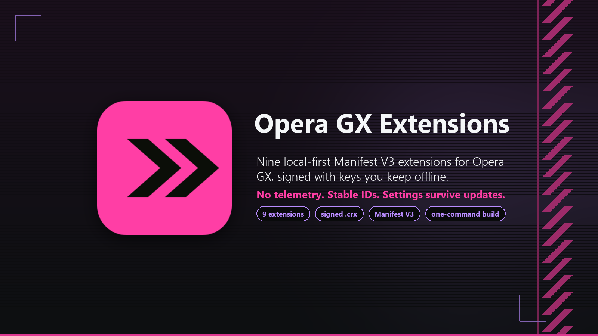
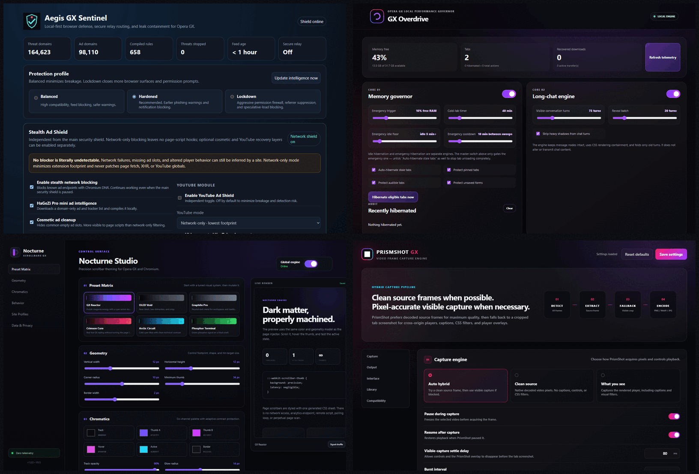
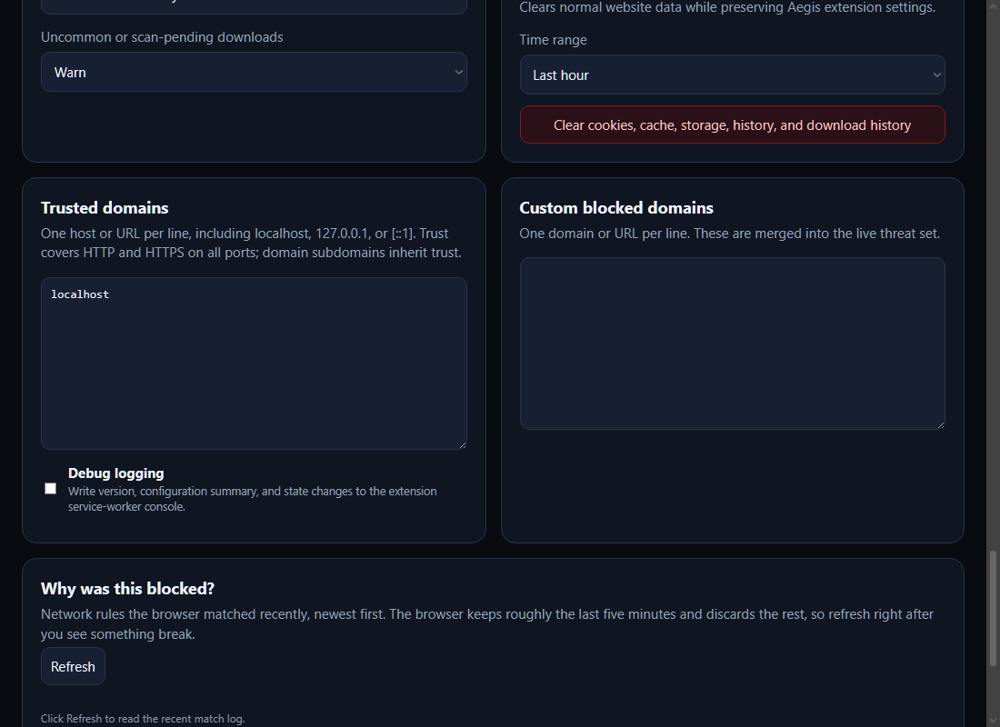
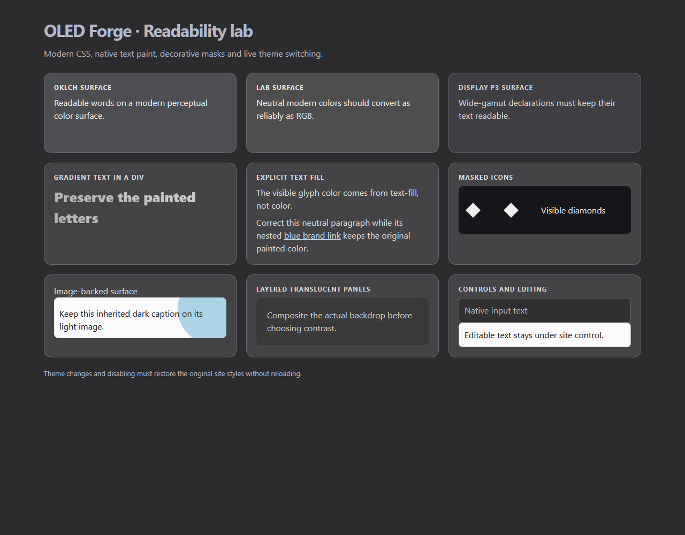
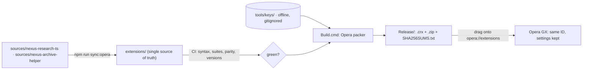

<div align="center">



[](https://github.com/SenjuWoo/Opera-GX-Extensions/actions/workflows/ci.yml)
[](https://github.com/SenjuWoo/Opera-GX-Extensions/releases/latest)
[](extensions)
[](.github/workflows/ci.yml)
[](LICENSE)

**[Install](#install)** · **[The extensions](#what-you-get)** · **[Build](#build)** · **[Signing](#signing-keys)** · **[How it works](#how-it-works)** · **[Status](#honest-status)** · **[Changelog](CHANGELOG.md)**

</div>

Eight signed extensions, one optional Nexus Mods helper, and the one-command packer
that builds `.crx` + `.zip` + `SHA256SUMS.txt`. Opera GX's packer can sign a real
`.crx` from a private key you keep offline. These extensions are written to that
path: no store listing required, IDs stable across unpacked and packed installs,
settings survive version bumps.

No developer telemetry, analytics, or remote executable code. NEXUS Research uses
your OpenRouter key; the optional Nexus Archive Helper uses your Nexus API key.
Site resources, threat feeds and downloads still use the network.

## What you get

| Extension | Version | What it does |
| --- | --- | --- |
| [GX Overdrive](extensions/gx-overdrive) | 1.2.4 | Performance governor: two-engine tab hibernation, long-chat folding for ChatGPT / Claude / Gemini / Perplexity, media throttling, download recovery |
| [Aegis GX Sentinel](extensions/aegis-gx-sentinel) | 1.3.7 | Privacy and threat shield: stealth ad / tracker blocking, phishing and malware defence, leak protection, per-rule block log |
| [NebulaGrab](extensions/nebulagrab) | 1.3.3 | Media detector with resumable downloads, HLS / DASH fragment capture, Smart Fetch |
| [PopShield GX](extensions/popshield-gx) | 1.0.4 | Popup, popunder, click-hijack and interstitial blocker — behavioural, not blocklist-driven |
| [Nocturne Scrollbars GX](extensions/nocturne-scrollbars-gx) | 1.1.2 | Dark modern scrollbars with presets, per-site profiles, adaptive contrast |
| [NEXUS Research](extensions/nexus-research) | 1.0.4 | Deep web research through OpenRouter with page intelligence and citations |
| [OLED Forge GX](extensions/oled-forge-gx) | 1.0.3 | True-black OLED treatment |
| [PrismShot GX](extensions/prismshot-gx) | 1.0.2 | Video frame capture |

Optional, not essential:

| Extension | Version | What it does |
| --- | --- | --- |
| [Nexus Archive Helper](extensions/nexus-archive-helper) | 1.1.3 | Resolves archived, old, hidden-page and deleted Nexus Mods files via the official Nexus API |




<p align="center"><sub>Real headless renders: Chromium loaded every folder under <code>extensions/</code> unpacked, all nine IDs matched the pinned keys, and each popup, side panel and options page was captured on a fresh profile with default settings.</sub></p>

In native Opera GX (isolated test profiles):



Trusted hosts cover HTTP and HTTPS on all ports; optional debug diagnostics remain local.



OLED regression coverage includes modern CSS colors, gradient text, masks and captions over preserved images. This controlled fixture has all nine extensions loaded.

## Install

Download the `.crx` for what you want from the [latest release](https://github.com/SenjuWoo/Opera-GX-Extensions/releases/latest) or [`Release/`](Release) and drag it onto `opera://extensions`.

Chrome, Edge and Brave reject any `.crx` without a Web Store publisher signature. On those, use the `.zip`: unpack it, then Developer mode → Load unpacked.

**NEXUS Research 1.0.4 ships as a `.zip` only.** Its newest signed `.crx` is 1.0.3, which stays in the release until the signing key is available again (see [Signing keys](#signing-keys)). The 1.0.4 ZIP carries the same pinned key, so it loads unpacked under the same extension ID. Loading it over an installed 1.0.3 `.crx` has not been tested; if you depend on saved research sessions, keep a backup copy first (the sessions archive has EXPORT JSON; there is no import), or stay on 1.0.3. 1.0.4 is a dependency refresh: rendered answers are identical.

Latest packaged GitHub release: [v2026.11.26](https://github.com/SenjuWoo/Opera-GX-Extensions/releases/tag/v2026.11.26) (NEXUS Research 1.0.4 ZIP plus the unchanged signed packages of the other eight extensions and Companion 1.3.2). Changelogs: [2026.11.26](Release/CHANGELOG-2026.11.26.txt), [2026.10.13](Release/CHANGELOG-2026.10.13.txt). See the [maintenance audit](AUDIT-2026-10-13.md).

## Build

```powershell
Build.cmd
```

One command. It validates every manifest, signs a `.crx` and `.zip` per extension into `Release\`, writes `SHA256SUMS.txt`, and reports what your browser is running against what was just built.

To package the optional companion distribution, run `pwsh -File tools/package-companion.ps1` before `Build.cmd`. Both packers use stable payload timestamps; repeated builds with the same source and packer produce the same bytes.

It uses Opera's own packer — no OpenSSL, no third-party signing tools. Node.js is used only to derive a public key from a signing key.

To ship an update: raise `version` in that extension's `manifest.json`, run `Build.cmd`, drag the new `.crx` in. Same key plus a higher version is an in-place update, so settings, toolbar position and permissions survive. Without the private keys, `Build.cmd` stops; see [Signing keys](#signing-keys) for the ZIP-only route.

`sources/nexus-research-ts` is the TypeScript project behind NEXUS. Its shipped bundle is committed under `extensions/nexus-research`; rebuild it with:

```powershell
cd sources/nexus-research-ts
npm ci
npm run sync:opera
```

`sources/nexus-archive-helper` is the project behind the optional helper. Rebuild and re-sync:

```powershell
cd sources/nexus-archive-helper
npm ci
npm run sync:opera
```

### The source gate

CI runs the same checks on every push: JavaScript syntax for every `.js` file, all 25 bundled extension suites, payload validation, runtime parity for both generated bundles, the TypeScript build and typecheck, companion tests, README/manifest version sync, and signing-identity preservation.


| Need | Command |
| --- | --- |
| Build and sign everything into `Release\` | `Build.cmd` |
| Companion package | `pwsh -File tools/package-companion.ps1` |
| README / manifest version sync | `node tools/check-versions.mjs` |
| Payload validator tests | `node tools/validate-extension.test.mjs` |
| Runtime parity tests | `node tools/runtime-parity.test.mjs` |
| NEXUS: test, build, parity | `npm test` · `npm run build` · `npm run verify:runtime` (in `sources/nexus-research-ts`) |
| Archive Helper: test, build, parity | `npm run verify` · `npm run verify:runtime` (in `sources/nexus-archive-helper`) |
| Companion tests | `python -m unittest discover -s sources/nebulagrab-companion/tests` |

## Signing keys

Each extension has a private key in `tools/keys/`, which is **gitignored and must stay that way**. The matching public key is pinned in the manifest as `key`, so an extension's ID comes from the key rather than from an install path. That is what lets the same folder be loaded unpacked and shipped as a `.crx` under one identity, and what makes folder renames harmless.

Lost a key? Restore its backup before building. The builder stops on missing or mismatched keys for existing extensions, preserving their identities and settings. Only an extension without a pinned identity can receive a new signing key.

All nine signing identities match the currently observed installed IDs. Older Archive Helper copies from another signing identity may still install separately; preserve their settings/key until migration succeeds.

**Current status: the private keys are not available to the builder,** so `Build.cmd` stops before packing (by design). Until they are restored, an updated extension ships as a `.zip` that keeps its pinned `key`, built with `python -I tools/package-zip-unsigned.py . <folder> Release/<slug>-v<version>.zip` from an LF checkout, and its last signed `.crx` stays published. When the keys are back, run `Build.cmd -NoZip` from an LF checkout to sign the `.crx` files without repacking the published ZIPs. New keys are deliberately not generated: a new key is a new extension ID, which would install as a separate extension and strand existing settings. The reasoning is in [DECISIONS.md](DECISIONS.md).

## How it works



```text
extensions/     one folder per extension — the single source of truth
Release/        signed .crx + .zip + SHA256SUMS.txt
tools/          build.ps1, pubkey.cjs, validators, parity checks
tools/keys/     private signing keys — gitignored, never published
sources/        build inputs that are not loadable extensions
docs/           screenshots and presentation images
_archive/       superseded copies, gitignored
```

- **Pinned identities.** The `key` in each manifest fixes the extension ID, so unpacked and packed installs share settings.
- **Generated code is checked, not trusted.** The NEXUS and Archive Helper bundles are rebuilt from source in CI and compared file by file with what ships.
- **Deterministic packages.** Stable payload timestamps mean the same source and packer produce the same bytes.

## Honest status

Verified in this tree:

- CI: JavaScript syntax, extension regressions, TypeScript/build checks, generated runtime parity, companion tests, versions and signing-identity preservation
- Manifest versions in the table above
- Signed CRX identities and tamper rejection; fresh ZIP payloads and native Opera downloads. See [audit coverage](AUDIT-2026-10-13.md).
- All nine extensions load unpacked in Chromium with IDs that match their pinned keys
- Root [LICENSE](LICENSE) is MIT

Not claimed:

- Chrome Web Store / Edge Add-ons publisher signatures (Chromium stores will refuse these `.crx` files)
- A third-party security audit of Aegis / PopShield
- That NEXUS Research or Archive Helper work without the API keys they ask for

## License

[MIT](LICENSE) for repository material unless a folder carries its own license.

Aegis GX Sentinel carries [GPL-3.0](extensions/aegis-gx-sentinel/LICENSE). Other per-folder licenses remain authoritative; bundled dependencies retain their own licenses.
