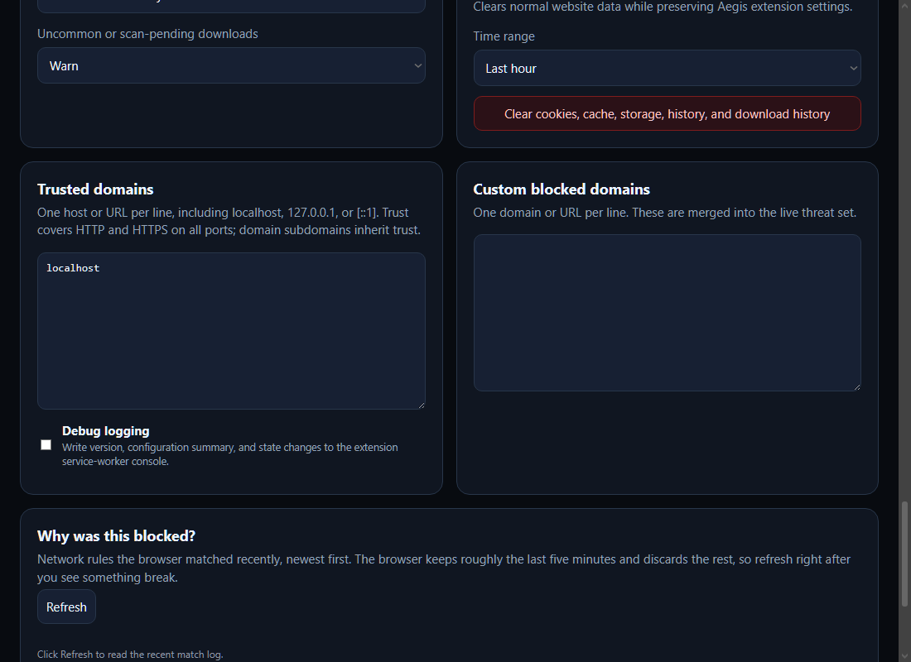
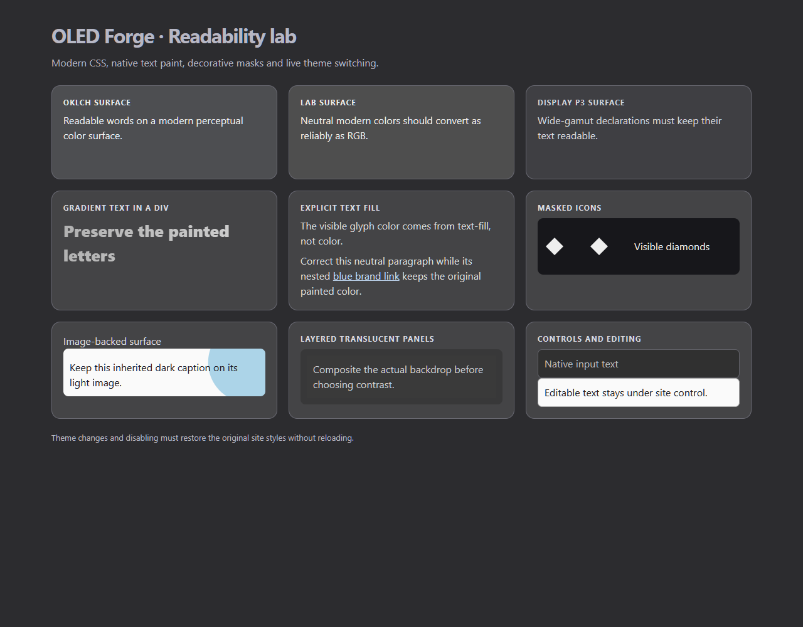

<p align="center">
  
</p>

<h1 align="center">Opera GX Extensions</h1>

<p align="center"><strong>Local-first Manifest V3 tools for Opera GX.</strong></p>

<p align="center">
  Eight signed extensions, one optional Nexus Mods helper,<br>
  and the one-command packer that builds `.crx` + `.zip` + `SHA256SUMS.txt`.
</p>

<p align="center">
  <a href="https://github.com/SenjuWoo/Opera-GX-Extensions/actions/workflows/ci.yml"></a>
  <a href="LICENSE"></a>
  <a href="https://github.com/SenjuWoo/Opera-GX-Extensions/releases/tag/v2026.10.13"></a>
  
</p>

<p align="center">
  <a href="#install">Install</a>
  ·
  <a href="#build">Build</a>
  ·
  <a href="#signing-keys">Signing</a>
  ·
  <a href="#honest-status">Status</a>
</p>

## Why it exists

Opera GX's packer can sign a real `.crx` from a private key you keep offline. These extensions are written to that path: no store listing required, IDs stable across unpacked and packed installs, settings survive version bumps.

No developer telemetry, analytics, or remote executable code. NEXUS Research uses your OpenRouter key; optional Nexus Archive Helper uses your Nexus API key. Site resources, threat feeds and downloads still use the network.



Trusted hosts cover HTTP and HTTPS on all ports; optional debug diagnostics remain local.



OLED regression coverage includes modern CSS colors, gradient text, masks and captions over preserved images. This controlled fixture has all nine extensions loaded.

## What you get

| Extension | Version | What it does |
| --- | --- | --- |
| [GX Overdrive](extensions/gx-overdrive) | 1.2.4 | Performance governor: two-engine tab hibernation, long-chat folding for ChatGPT / Claude / Gemini / Perplexity, media throttling, download recovery |
| [Aegis GX Sentinel](extensions/aegis-gx-sentinel) | 1.3.7 | Privacy and threat shield: stealth ad / tracker blocking, phishing and malware defence, leak protection, per-rule block log |
| [NebulaGrab](extensions/nebulagrab) | 1.3.3 | Media detector with resumable downloads, HLS / DASH fragment capture, Smart Fetch |
| [PopShield GX](extensions/popshield-gx) | 1.0.4 | Popup, popunder, click-hijack and interstitial blocker — behavioural, not blocklist-driven |
| [Nocturne Scrollbars GX](extensions/nocturne-scrollbars-gx) | 1.1.2 | Dark modern scrollbars with presets, per-site profiles, adaptive contrast |
| [NEXUS Research](extensions/nexus-research) | 1.0.3 | Deep web research through OpenRouter with page intelligence and citations |
| [OLED Forge GX](extensions/oled-forge-gx) | 1.0.3 | True-black OLED treatment |
| [PrismShot GX](extensions/prismshot-gx) | 1.0.2 | Video frame capture |

Optional, not essential:

| Extension | Version | What it does |
| --- | --- | --- |
| [Nexus Archive Helper](extensions/nexus-archive-helper) | 1.1.3 | Resolves archived, old, hidden-page and deleted Nexus Mods files via the official Nexus API |

## Install

Download the `.crx` for what you want from the [latest release](https://github.com/SenjuWoo/Opera-GX-Extensions/releases/latest) or [`Release/`](Release) and drag it onto `opera://extensions`.

Chrome, Edge and Brave reject any `.crx` without a Web Store publisher signature. On those, use the `.zip`: unpack it, then Developer mode → Load unpacked.

Latest packaged GitHub release: [v2026.10.13](https://github.com/SenjuWoo/Opera-GX-Extensions/releases/tag/v2026.10.13) (all nine extensions and Companion 1.3.2). See the [maintenance audit](AUDIT-2026-10-13.md) and [plain-text changelog](Release/CHANGELOG-2026.10.13.txt).

## Build

```powershell
Build.cmd
```

One command. It validates every manifest, signs a `.crx` and `.zip` per extension into `Release\`, writes `SHA256SUMS.txt`, and reports what your browser is running against what was just built.

To package the optional companion distribution, run `pwsh -File tools/package-companion.ps1` before `Build.cmd`. Both packers use stable payload timestamps; repeated builds with the same source and packer produce the same bytes.

It uses Opera's own packer — no OpenSSL, no third-party signing tools. Node.js is used only to derive a public key from a signing key.

To ship an update: raise `version` in that extension's `manifest.json`, run `Build.cmd`, drag the new `.crx` in. Same key plus a higher version is an in-place update, so settings, toolbar position and permissions survive.

## Project map

```text
extensions/     one folder per extension — the single source of truth
Release/        signed .crx + .zip + SHA256SUMS.txt
tools/          build.ps1, pubkey.cjs
tools/keys/     private signing keys — gitignored, never published
sources/        build inputs that are not loadable extensions
_archive/       superseded copies, gitignored
```

`sources/nexus-research-ts` is the TypeScript project behind NEXUS. Its shipped bundle is committed under `extensions/nexus-research`; rebuild it with:

```powershell
cd sources/nexus-research-ts
npm ci
npm run sync:opera
```

`sources/nexus-archive-helper` is the project behind the optional helper. Rebuild and re-sync:

```powershell
cd sources/nexus-archive-helper
npm ci
npm run sync:opera
```

## Signing keys

Each extension has a private key in `tools/keys/`, which is **gitignored and must stay that way**. The matching public key is pinned in the manifest as `key`, so an extension's ID comes from the key rather than from an install path. That is what lets the same folder be loaded unpacked and shipped as a `.crx` under one identity, and what makes folder renames harmless.

Lost a key? Restore its backup before building. The builder stops on missing or mismatched keys for existing extensions, preserving their identities and settings. Only an extension without a pinned identity can receive a new signing key.

All nine signing identities match the currently observed installed IDs. Older Archive Helper copies from another signing identity may still install separately; preserve their settings/key until migration succeeds.

## Honest status

Verified in this tree:

- CI: JavaScript syntax, extension regressions, TypeScript/build checks, generated runtime parity, companion tests, versions and signing-identity preservation
- Manifest versions in the table above
- Signed CRX identities and tamper rejection; fresh ZIP payloads and native Opera downloads. See [audit coverage](AUDIT-2026-10-13.md).
- Root [LICENSE](LICENSE) is MIT

Not claimed:

- Chrome Web Store / Edge Add-ons publisher signatures (Chromium stores will refuse these `.crx` files)
- A third-party security audit of Aegis / PopShield
- That NEXUS Research or Archive Helper work without the API keys they ask for

## License

[MIT](LICENSE) for repository material unless a folder carries its own license.

Aegis GX Sentinel carries [GPL-3.0](extensions/aegis-gx-sentinel/LICENSE). Other per-folder licenses remain authoritative; bundled dependencies retain their own licenses.
